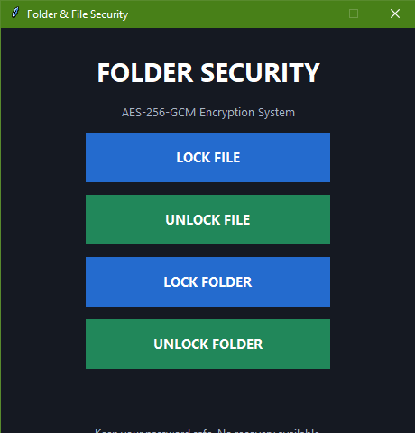

# 🛡️ Folder/File Encryption
***A lightweight, highly secure, and modern desktop application built for 
seamless file and folder encryption 
using industry-standard cryptography. Designed with a clean GUI and powered by Python.***

## ✨ Key Features
1. **Military-Grade Encryption:** Utilizes AES-256-GCM (Galois/Counter Mode) via the robust cryptography library to ensure both data confidentiality and integrity.

2. **Dual Encryption Modes:**
 
 * 📄 **File Mode:** Secure individual files of any format (Documents, Images, Archives, etc.).

 * 📁 **Folder Mode:** Recursively encrypts entire directories while preserving your folder structure.

3. **Intuitive Desktop GUI:** Built using tkinter, offering a clean, distraction-free interface with a custom aesthetic and professional app branding.

4. **Zero-Knowledge Security:** Your master password never leaves your machine; decryption is entirely client-side and mathematically bound to your secret key.

5. **Standalone Executable:** Fully compiled into a single, portable .exe file (--onefile) with integrated multi-resolution app icons—no Python installation required for end-users.

## 📁 Project Structure

```text
File-Folder-Encryption/
├── assets/
│   ├── icon.ico
│   └── app_preview.png
├── dist/
│   └── file-folder_encrypt.exe        # Main Executable File
├── file-folder_encrypt.py             # Main Application Code
├── README.md                          # Project Documentation
└── LICENSE.md                         # Open-source License
```

## 🚀 Quick Start (For Developers / Python user)
1. **Clone the repository:**

```Bash
git clone https://github.com/your-username/folder-encryption-app.git
cd folder-encryption-app
```


2. **Run the application:**

```Bash
python folder_encrypt.py
```
## 🚀 Quick Start (For End-Users / Executable)

Agar aapke system me Python installed nahi hai aur aap seedha compiled application run karna chahte hain:

1. **Download the Executable:**
   * Go to the **[Releases](https://github.com/your-username/folder-encryption-app/releases)** section of this repository.
   * Download the latest `file-folder_encrypt.exe` file.

2. **Run the Application:**
   * Double-click on `file-folder_encrypt.exe` to launch the graphical user interface.
   * Select your target file or folder, enter your secure password, and encrypt/decrypt instantly!

## 📸 Application Screenshot



## 🔒 Cryptographic Design

- **Cipher:** AES-256-GCM (Authenticated Encryption)
- **Key Derivation:** PBKDF2HMAC with SHA-256 (Salted per operation)
- **Integrity Check:** Automatic verification via GCM authentication tag to prevent tampering.


## ⚠️ Disclaimer & License

Distributed under the **MIT License**. 

> **Note:** Master passwords are not stored anywhere. If you lose your password, encrypted data cannot be recovered. Always keep your passwords safe!
